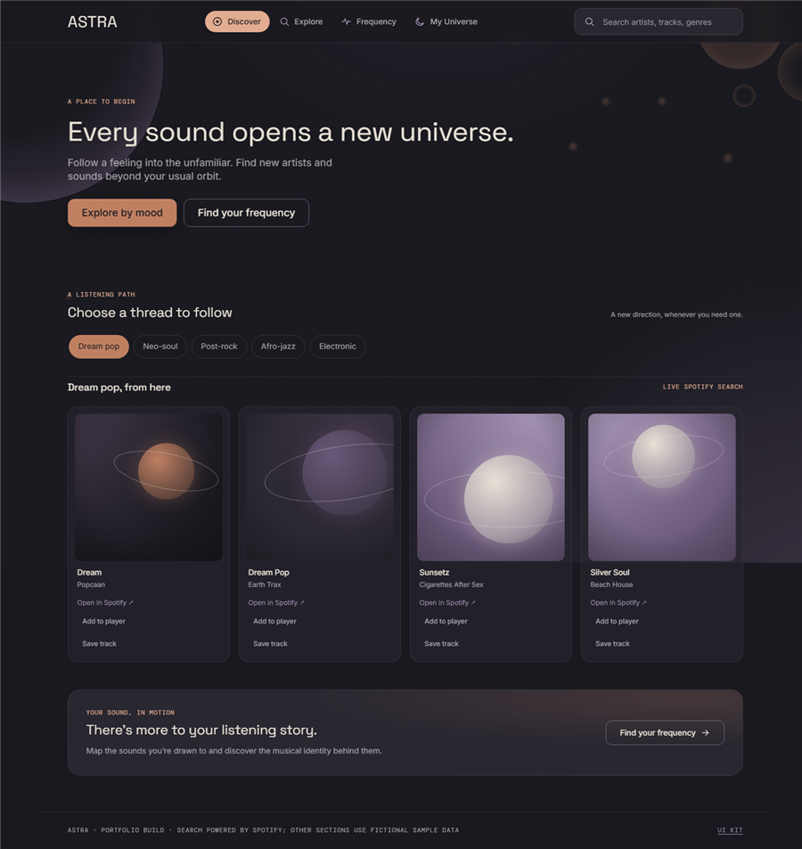

# ASTRA

**Every sound opens a new universe.**

ASTRA is an atmospheric music discovery app that nudges listeners beyond their usual orbit: wander by mood, genre and atmosphere, discover your musical identity, and gather the sounds you find into a personal universe.

**[Live app →](https://astra-music-app.netlify.app)**



## Features

- **Discover**: listening paths through genres like dream pop, neo-soul and Afro-jazz, with live Spotify results.
- **Explore**: wander by mood, genre or atmosphere, with results curated from the Spotify catalogue.
- **Your Frequency**: a short quiz with an "orbiting moods" interaction that maps your taste to one of eight musical identities.
- **My Universe**: save tracks, artists and discoveries, build playlists, and (once you connect Spotify) see your liked songs, followed artists and playlists.
- **Now Playing**: a draggable, orbital player built on Spotify's embed, with an optional visualiser that reacts to the music.
- **Search**: live artist and track search from the header.

## Built with

- **Frontend**: React 19, Vite, plain CSS with design tokens. No UI kit or CSS framework.
- **Backend**: Python, FastAPI and httpx.
- **Data**: Spotify Web API, with OAuth login and the Spotify iFrame embed for playback.
- **Hosting**: Netlify (frontend) and Render (backend).

## How it works

```
Browser ──▶ Netlify (React app)
              │  /api/* is proxied
              ▼
           Render (FastAPI) ──▶ Spotify Web API
```

- **Credentials stay on the server.** The FastAPI backend holds the Spotify client secret and users' access tokens. The browser only ever gets an opaque, HttpOnly session cookie, so tokens are never exposed to JavaScript.
- **One origin, no CORS.** Netlify proxies `/api/*` to the backend, as Vite's proxy does in development, so the login cookie just works.
- **Designed around Spotify's 2026 limits.** Apps in Development Mode can't use recommendations, related artists, audio features or preview clips. ASTRA's mood paths and Frequency results are therefore its own logic, built from genre and style searches rather than Spotify's recommendation engine.
- **Never broken, always honest.** If the API is asleep, offline or unconfigured, the app falls back to fictional sample data. Every item is labelled with its source (Spotify or sample), so nothing pretends to be live when it isn't.
- **A reactive visualiser without audio access.** Spotify's embed doesn't expose its audio, so the visualiser uses screen-share audio capture (`getDisplayMedia`) and the Web Audio API to drive the geometry and spectrum, with the listener's permission.

## Design

The "Atmospheric Cosmic" identity uses deep charcoal and smoky violet with copper accents, subtle orbital shapes and restrained glass effects, deliberately avoiding the look of a generic streaming app. All colours, type and spacing come from a single token file (`src/styles/tokens.css`), and the UI kit is browsable in the app at [`#/kit`](https://astra-music-app.netlify.app/#/kit).

Accessibility is built in: semantic HTML, visible focus states, keyboard support (including moving the player with the arrow keys) and `prefers-reduced-motion`.

## Run locally

You need Node.js, Python 3.10+ and a [Spotify developer app](https://developer.spotify.com/dashboard).

```bash
# Backend (terminal 1)
cd backend
python -m venv .venv
.venv\Scripts\python -m pip install -r requirements.txt   # macOS/Linux: .venv/bin/python
copy .env.example .env                                    # then add your Spotify keys
.venv\Scripts\python -m uvicorn app.main:app --reload --host 127.0.0.1 --port 8000

# Frontend (terminal 2)
npm install
npm run dev
```

Open http://127.0.0.1:5173. Use `127.0.0.1` rather than `localhost`, because Spotify's redirect URI and the session cookie depend on it. Without Spotify keys, the app runs on its labelled sample data.

See [backend/README.md](backend/README.md) for the API endpoints and deployment.

## Project structure

```
src/
  pages/        Discover, Explore, Frequency, My Universe, UI kit
  components/   layout, ui, cards, player, universe
  services/     the only code that calls the API (with sample-data fallback)
  styles/       design tokens and global styles
backend/app/    FastAPI app, Spotify client, sessions, response mappers
design/         brand identity, palette, typography and UI component references
```

---

Designed and built by [Zoe Blighton](https://zoeblighton.com). Music data and playback provided by [Spotify](https://www.spotify.com).
